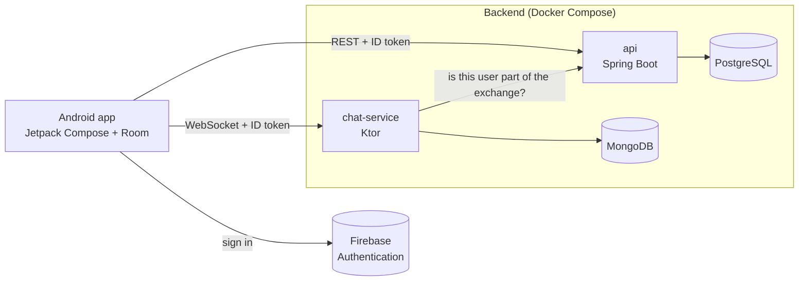

# BookinTok

[](https://github.com/josesc03/bookintok/actions/workflows/backend.yml)
[](https://github.com/josesc03/bookintok/actions/workflows/android.yml)

BookinTok is a mobile app for **swapping books with people nearby**: you publish the books you want to
give away, find others around you, chat with their owner and confirm the swap. Afterwards you can rate
each other.

This is version 2 of my final project for the DAM degree (2025). I rebuilt it from scratch to apply
what I have learned since: a backend split into two services, automated tests on real databases, CI,
and containers.

> 🇪🇸 **Resumen:** app Android para intercambiar libros con gente cercana. Backend en Kotlin con dos
> servicios: una API REST en **Spring Boot** sobre PostgreSQL y un servicio de chat en tiempo real en
> **Ktor** con WebSockets y MongoDB. Todo se arranca con `docker compose up`.

## Architecture



| Module | Stack | Responsibility |
|---|---|---|
| [`backend/api`](backend/api) | Kotlin, Spring Boot 4, Spring Data JPA, Spring Security, Flyway, PostgreSQL | Users, books, geographic search, exchanges, ratings |
| [`backend/chat-service`](backend/chat-service) | Kotlin, Ktor 3, coroutines, WebSockets, MongoDB | Real-time chat of each exchange and its message history |
| [`frontend`](frontend) | Kotlin, Jetpack Compose, Material 3, Hilt, Room, Ktor client | Android app with offline chat history |

## Design decisions

**Two services, each with the tool that fits it.** The API is classic transactional CRUD with business
rules, which is where Spring Boot and JPA shine. The chat keeps many long-lived connections open, a
natural fit for Ktor's coroutine-based server. Both are written in Kotlin, so the whole project uses a
single language.

**PostgreSQL for the domain, MongoDB for messages.** Users, books and exchanges are relational and need
constraints and transactions. Chat messages are an append-only stream that is always read by exchange
and date, which is a good fit for a document store with a compound index `(exchangeId, sentAt)`.

**No service account keys.** Firebase ID tokens are standard JWTs signed by Google. Both services check
them against Google's public keys (Spring Security's OAuth2 resource server, Ktor's `auth-jwt`), so the
backend needs no Firebase secret at all: the only configuration is the project id.

**The API owns exchanges; the chat does not copy them.** When someone opens a chat, `chat-service` asks
the API about the exchange **using the user's own token**. The API answers only to the exchange's
participants, so access rules live in one place. Closed exchanges stay readable but read-only.

**Concurrency is handled explicitly.** An exchange completes when both users confirm it. `@Version`
optimistic locking stops two simultaneous confirmations, or two exchanges of the same book, from
overwriting each other, and a partial unique index allows only one open request per user and book.

**Distance search runs in the database.** A bounding box (index-friendly) narrows the candidates and
the Haversine formula, built with the JPA Criteria API, gives the exact distance. Results stay correct
and paginated.

## Tests

```powershell
cd backend
./gradlew test
```

Backend: 46 tests. The integration tests start **real PostgreSQL and MongoDB containers** with Testcontainers
(Docker is required):

- **api**: domain unit tests (exchange state machine, geographic maths) and HTTP tests of every
  endpoint with MockMvc: authentication, validation, permissions, the full exchange flow and ratings.
- **chat-service**: WebSocket tests with two connected users, history pagination, the API client
  (with Ktor's `MockEngine`) and the MongoDB repository.

Android: 18 JVM tests (Room with Robolectric, network with Ktor `MockEngine`); see [frontend/README.md](frontend/README.md).

CI runs every suite, builds both Docker images and the debug APK ([backend](.github/workflows/backend.yml), [android](.github/workflows/android.yml)).

## Running it

You need Docker and a Firebase project (its id only; no keys).

```powershell
cp .env.example .env   # then set POSTGRES_PASSWORD and FIREBASE_PROJECT_ID
docker compose up --build
```

| Service | URL |
|---|---|
| API | http://localhost:8080 · interactive docs at http://localhost:8080/docs |
| Chat | `ws://localhost:8081/ws/exchanges/{id}` · history at `GET /api/v1/exchanges/{id}/messages` |

Every request needs a Firebase ID token: `Authorization: Bearer <token>`.

## API overview

| Area | Endpoints |
|---|---|
| Users | `POST /api/v1/users/me` · `GET/PATCH /api/v1/users/me` · `PUT /api/v1/users/me/location` · `GET /api/v1/users/{uid}` |
| Books | `GET /api/v1/books?q=&language=&category=&coverType=&condition=&maxDistanceKm=` · `POST /api/v1/books` · `GET/PUT/DELETE /api/v1/books/{id}` · `GET /api/v1/users/{uid}/books` |
| Exchanges | `POST /api/v1/books/{id}/exchanges` · `GET /api/v1/exchanges?status=` · `GET /api/v1/exchanges/{id}` · `POST /api/v1/exchanges/{id}/confirmation` · `POST /api/v1/exchanges/{id}/cancellation` |
| Ratings | `GET/POST /api/v1/users/{uid}/ratings` |

Errors follow [RFC 9457 Problem Details](https://www.rfc-editor.org/rfc/rfc9457).

## Roadmap

- [x] API in Spring Boot with tests on PostgreSQL
- [x] Chat service in Ktor with MongoDB
- [x] Docker Compose and CI
- [x] Android app: MVVM, Hilt, Room cache so past conversations can be read offline
- [ ] Image upload to Firebase Storage
- [ ] Chat broadcast across several instances (Redis pub/sub or MongoDB change streams)
