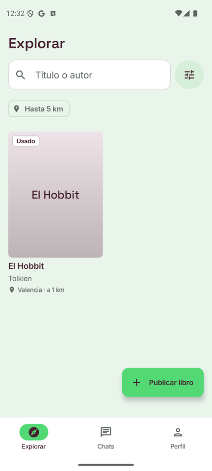
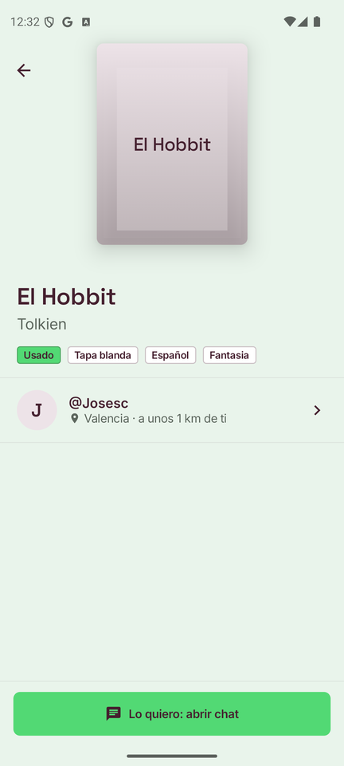
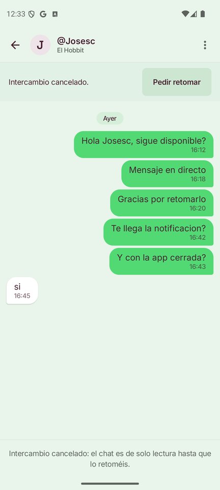
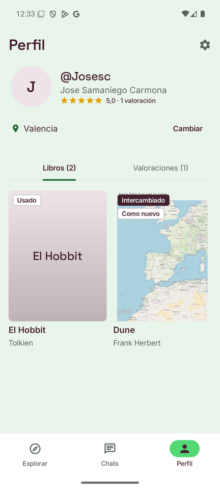
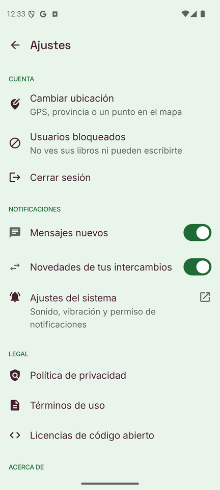
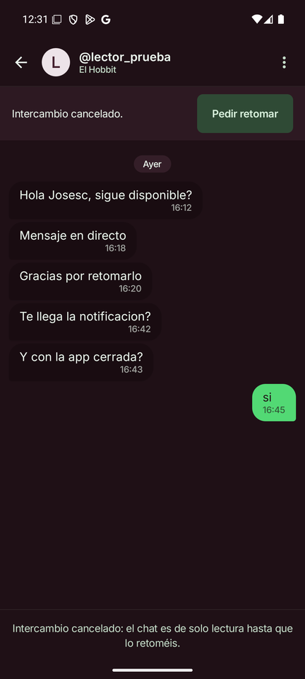
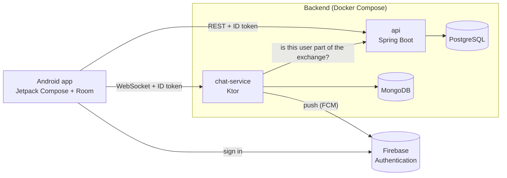

# Bookintok

[](https://github.com/josesc03/bookintok/actions/workflows/backend.yml)
[](https://github.com/josesc03/bookintok/actions/workflows/android.yml)

Bookintok is a mobile app for **swapping books with people nearby**: you publish the books you want to
give away, find others around you, chat with their owner and confirm the swap. Afterwards you can rate
each other.

This is version 2 of my final project for the DAM degree (2025). I rebuilt it from scratch to apply
what I have learned since: a backend split into two services, automated tests on real databases, CI,
and containers.

> 🇪🇸 **Resumen:** app Android para intercambiar libros con gente cercana. Backend en Kotlin con dos
> servicios: una API REST en **Spring Boot** sobre PostgreSQL y un servicio de chat en tiempo real en
> **Ktor** con WebSockets y MongoDB. Todo, incluido el APK, se construye y arranca con
> `docker compose up -d --build`.

<p align="center">
  
</p>

| Explore | Book | Chat | Profile | Settings | Dark mode |
|---|---|---|---|---|---|
|  |  |  |  |  |  |

**Try it:** download the APK from [Releases](https://github.com/josesc03/bookintok/releases/latest). It talks to a
backend on your own machine (see [Running it](#running-it)); there is no public server.

## Features

- **Books nearby**: publish books with a photo and search by title, author, language, condition and distance.
- **One chat per book and reader**: asking again for the same book takes you back to the existing chat.
- **Exchanges**: both people confirm the swap and then rate each other. A cancelled chat becomes read-only
  until one side asks to resume and the other accepts.
- **Real time**: messages, unread counters and exchange updates arrive live over WebSockets; past
  conversations stay readable offline.
- **Push notifications** (Firebase Cloud Messaging) when the app is closed, only for users who are not
  already looking at it, and each kind can be turned off in Settings.
- **Safety**: report and block users. Blocking cancels open chats, hides each other's books and stops
  new requests.
- **Privacy**: location stored on a ~1 km grid, photo metadata stripped, account deletion that erases
  everything in PostgreSQL, MongoDB and Firebase. [Privacy policy](docs/privacy-policy.md) ·
  [Terms of use](docs/terms-of-use.md).
- **Polish**: light and dark themes, adaptive and themed icon, Android 12 splash screen.

## Architecture



| Module | Stack | Responsibility |
|---|---|---|
| [`backend/api`](backend/api) | Kotlin, Spring Boot 4, Spring Data JPA, Spring Security, Flyway, PostgreSQL | Users, books, geographic search, exchanges, ratings |
| [`backend/chat-service`](backend/chat-service) | Kotlin, Ktor 3, coroutines, WebSockets, MongoDB, Firebase Admin | Real-time chat of each exchange, its history, the per-user inbox and push notifications |
| [`frontend`](frontend) | Kotlin, Jetpack Compose, Material 3, Hilt, Room, Ktor client | Android app with offline chat history |

## Design decisions

**Two services, each with the tool that fits it.** The API is classic transactional CRUD with business
rules, which is where Spring Boot and JPA shine. The chat keeps many long-lived connections open, a
natural fit for Ktor's coroutine-based server. Both are written in Kotlin, so the whole project uses a
single language.

**PostgreSQL for the domain, MongoDB for messages.** Users, books and exchanges are relational and need
constraints and transactions. Chat messages are an append-only stream that is always read by exchange
and date, which is a good fit for a document store with a compound index `(exchangeId, sentAt)`.

**Authentication without secrets.** Firebase ID tokens are standard JWTs signed by Google. Both services
check them against Google's public keys (Spring Security's OAuth2 resource server, Ktor's `auth-jwt`), so
signing in needs no Firebase secret: only the project id. The one optional key is a service account,
mounted from the git-ignored `secrets/` folder, used to send push notifications and to delete Firebase
accounts. Without it everything else still works.

**The API owns exchanges; the chat does not copy them.** When someone opens a chat, `chat-service` asks
the API about the exchange **using the user's own token**. The API answers only to the exchange's
participants, so access rules live in one place. Closed exchanges stay readable but read-only.

**Concurrency is handled explicitly.** An exchange completes when both users confirm it. `@Version`
optimistic locking stops two simultaneous confirmations, or two exchanges of the same book, from
overwriting each other, and a partial unique index allows only one open request per user and book.

**Location privacy by design.** Users say where they are with the GPS, by picking their province
(autonomous community → province) or by tapping a map. The API only ever stores that point snapped
to a ~1 km grid, plus a place name. Other users see the place name and a distance rounded up to whole
kilometres, never coordinates. Book photos are re-encoded on upload, which drops EXIF data such as
the GPS position where the photo was taken.

**An inbox socket per user.** Besides the socket of an open chat, the app keeps one `/ws/inbox` socket
while it is in the foreground. Every message and exchange change fans out to the inbox of each
participant, which drives the unread badges. Push notifications go only to users with no inbox open, so
nobody gets a notification for the chat they are reading.

**Distance search runs in the database.** A bounding box (index-friendly) narrows the candidates and
the Haversine formula, built with the JPA Criteria API, gives the exact distance. Results stay correct
and paginated.

## Tests

```powershell
cd backend
./gradlew test
```

Backend: 80 tests. The integration tests start **real PostgreSQL and MongoDB containers** with Testcontainers
(Docker is required):

- **api**: domain unit tests (exchange state machine, geographic maths) and HTTP tests of every
  endpoint with MockMvc: authentication, validation, permissions, the full exchange flow and ratings.
- **chat-service**: WebSocket tests with two connected users, history pagination, the API client
  (with Ktor's `MockEngine`) and the MongoDB repository.

Android: 36 JVM tests (Room with Robolectric, network with Ktor `MockEngine`); see [frontend/README.md](frontend/README.md).

CI runs every suite, builds both Docker images and the debug APK ([backend](.github/workflows/backend.yml), [android](.github/workflows/android.yml)).

## Running it

You need Docker and a Firebase project.

```powershell
cp .env.example .env   # set POSTGRES_PASSWORD and the Firebase values
docker compose up -d --build
```

This builds and starts everything: PostgreSQL, MongoDB, the API and the chat service. The `android`
service builds the APK inside a container (JDK + Android SDK), copies it to `dist/bookintok.apk` and
exits. Install it with `adb install -r dist/bookintok.apk`. By default the APK points to `10.0.2.2`,
which is your machine as seen from the Android emulator. For a real phone, set `APK_API_BASE_URL` and
`APK_CHAT_BASE_URL` in `.env` to your computer's LAN address.

For push notifications, put a Firebase service account key at `secrets/firebase-service-account.json`
(git-ignored).

| Service | URL |
|---|---|
| API | http://localhost:8080 · interactive docs at http://localhost:8080/docs |
| Chat | `ws://localhost:8081/ws/exchanges/{id}` · `ws://localhost:8081/ws/inbox` · history at `GET /api/v1/exchanges/{id}/messages` |

Every request needs a Firebase ID token: `Authorization: Bearer <token>`.

## API overview

| Area | Endpoints |
|---|---|
| Users | `POST /api/v1/users/me` · `GET/PATCH/DELETE /api/v1/users/me` · `PUT /api/v1/users/me/location` · `GET /api/v1/users/{uid}` |
| Books | `GET /api/v1/books?q=&language=&category=&coverType=&condition=&maxDistanceKm=` · `POST /api/v1/books` · `GET/PUT/DELETE /api/v1/books/{id}` · `GET /api/v1/users/{uid}/books` |
| Exchanges | `POST /api/v1/books/{id}/exchanges` · `GET /api/v1/exchanges?status=` · `GET /api/v1/exchanges/{id}` · `POST /api/v1/exchanges/{id}/confirmation` · `POST /api/v1/exchanges/{id}/cancellation` · `PUT/DELETE /api/v1/exchanges/{id}/archive` |
| Resuming | `POST/DELETE /api/v1/exchanges/{id}/reopen-request` · `POST /api/v1/exchanges/{id}/reopen-acceptance` |
| Safety | `GET /api/v1/users/me/blocks` · `PUT/DELETE /api/v1/users/me/blocks/{uid}` · `POST /api/v1/users/{uid}/reports` |
| Chat service | `GET /api/v1/inbox` · `PUT/DELETE /api/v1/devices` · `DELETE /api/v1/me` |
| Ratings | `GET/POST /api/v1/users/{uid}/ratings` |

Errors follow [RFC 9457 Problem Details](https://www.rfc-editor.org/rfc/rfc9457).

## Roadmap

- [x] API in Spring Boot with tests on PostgreSQL
- [x] Chat service in Ktor with MongoDB
- [x] Docker Compose and CI
- [x] Android app: MVVM, Hilt, Room cache so past conversations can be read offline
- [x] Google sign-in and email verification (enforced by both services)
- [x] Book photos, scaled and stripped of metadata by the API
- [x] Privacy-preserving location: GPS, province or map point, stored on a ~1 km grid
- [x] Real-time inbox, unread counters and push notifications
- [x] One chat per book, read-only cancelled chats and requests to resume
- [x] Report and block users, account deletion, privacy policy and terms
- [x] Dark theme, adaptive icon and splash screen
- [x] Whole project (APK included) built with Docker Compose
- [ ] Profile photos
- [ ] Chat broadcast across several instances (Redis pub/sub or MongoDB change streams)
