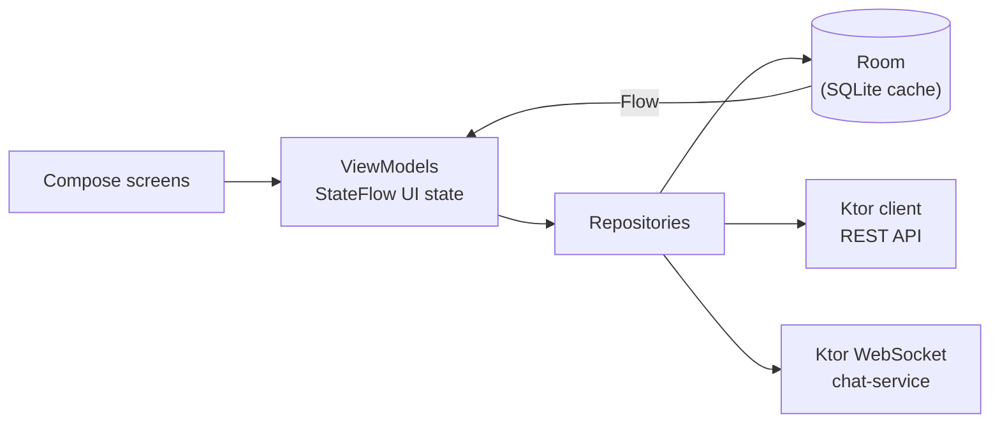

# BookinTok · Android app

Jetpack Compose client for the BookinTok backend. Users browse books nearby, request one, chat with
its owner and confirm the swap; **past conversations stay readable offline**.

## Architecture



- **MVVM with unidirectional data flow**: each screen has a ViewModel that exposes one immutable
  `StateFlow` of UI state; screens only render it and send events.
- **Room as the single source of truth for chats**: the chat screen and the conversation list read
  exchanges and messages from Room. The WebSocket and the history endpoint only *write* to Room. When
  there is no connection, the cached conversation is shown with a banner while the socket reconnects
  with exponential backoff (1 s → 30 s).
- **Hilt** for dependency injection; repositories are interfaces so ViewModels can be tested with fakes.
- **Design system from Hukly**: Space Grotesk for display text and Inter for the rest (both OFL,
  licences in `licenses/`), 8/12 dp radii, cards with a 2 dp ink border, and the Hukly palette with
  every hue rotated +113° (orange → green). Shared components live in `ui/components`.
- **Onboarding**: a welcome screen with a slide-up control, sign-in (Google or email with
  verification), profile, and a location step with three options: device location (coarse
  permission only), autonomous community → province (bundled `assets/spain_provinces.json`, INE
  names with Wikidata coordinates), or a point on an OpenStreetMap map (osmdroid, no API key).
- **Book photos** are picked with the system photo picker (no storage permission), compressed on the
  device and uploaded to the API.
- **Type-safe navigation** (Navigation Compose with `@Serializable` routes).
- **No secrets in the repository**: Firebase is configured at runtime from `local.properties`
  instead of a committed `google-services.json`, and only the emulator host may use plain HTTP
  (`network_security_config.xml`). On sign-out the local database is wiped.

| Package | Contents |
|---|---|
| `core/network` | API client, DTOs and error mapping (RFC 9457 Problem Details) |
| `core/database` | Room database, entities and DAOs (schema exported to `app/schemas`) |
| `core/auth` | Firebase Authentication and the ID-token provider |
| `data` | Repositories: books, users, exchanges (cached) and chat (cached + WebSocket) |
| `ui` | Screens and ViewModels: login, profile setup, books, book detail/editor, chats, chat, profile |
| `di` | Hilt modules |

## Running it

1. Start the backend from the repository root: `docker compose up --build`.
2. Create `frontend/local.properties` (it is git-ignored):

   ```properties
   sdk.dir=C:/Users/<you>/AppData/Local/Android/Sdk
   firebase.projectId=your-project-id
   firebase.appId=1:1234567890:android:abc123
   firebase.apiKey=your-web-api-key
   # Optional, defaults target the emulator (10.0.2.2 is the host machine):
   # bookintok.apiBaseUrl=http://10.0.2.2:8080
   # bookintok.chatBaseUrl=ws://10.0.2.2:8081
   ```

   The Firebase values are in Firebase console → Project settings → Your apps. Enable the
   *Email/Password* sign-in provider.
3. Open `frontend/` in Android Studio and run the app on an emulator.

## Tests

```powershell
./gradlew :app:testDebugUnitTest
```

They run on the JVM: Room in memory with Robolectric, the server with Ktor's `MockEngine`.

- **Chat repository**: history is cached in Room, the conversation is still readable when the
  network fails, older pages are requested with `before`, errors map to `ApiException`, reconnection
  backoff.
- **Exchange repository**: list ordering and the cache update after confirming.
- **API client**: query parameters, bearer token, Problem Details and validation messages.
- **ViewModels**: book search paging and filters, and the session flow (signed out, profile
  creation, offline start).
